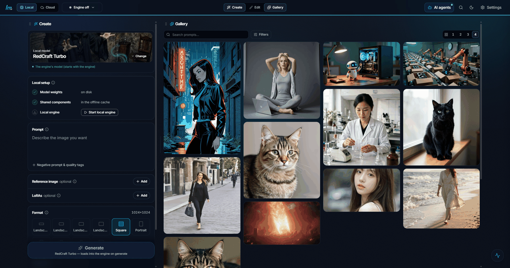
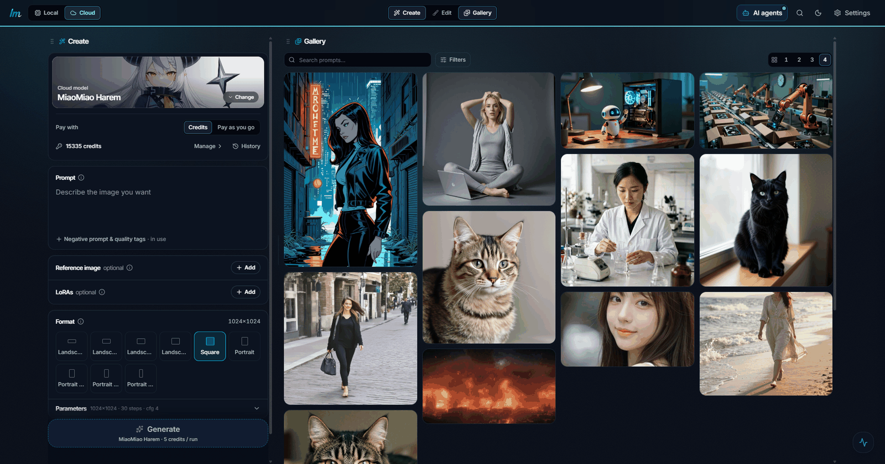
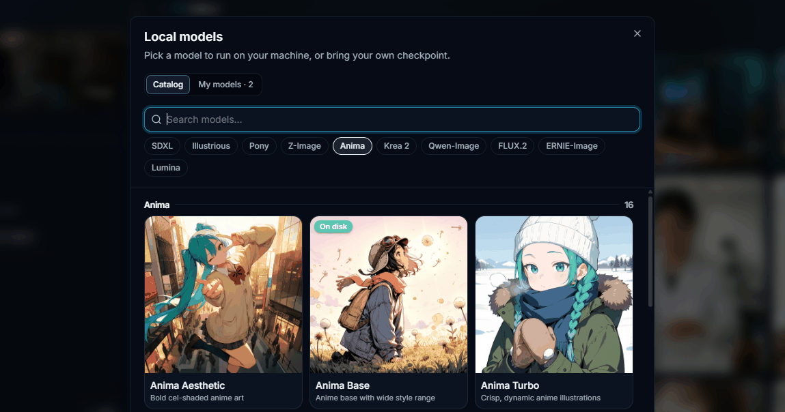
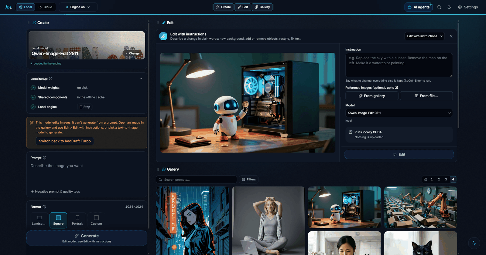

<div align="center">


# Imference Desktop

**AI images and video on your GPU or in the cloud. Same app, one switch.**
One-click setup. Models download themselves. No account.

Free · Open source · Windows & macOS

[](https://github.com/Publikey/imference-desktop/releases/latest)
[](https://github.com/Publikey/imference-desktop/releases)
[](https://github.com/Publikey/imference-desktop/actions)
[](LICENSE)
[](https://github.com/Publikey/imference-desktop/stargazers)
[](#download)

**English** · [简体中文](README.zh-CN.md)

[**Download**](#download) · [Quick start](#quick-start) · [Models](#models) · [Website](https://imference.com/desktop) · [Contributing](CONTRIBUTING.md) · [Security](SECURITY.md)



</div>

### 🔀 Local and cloud, one interface

Generate on your own GPU for free, or flip a switch and run the same prompt in
the cloud. Same screen, same gallery, same tools: nothing new to learn, and you
decide where each image runs.

<div align="center">

</div>

### ⚡ Running in minutes

Install, open, pick a model, hit Generate. The app sets up its own engine,
detects your GPU and downloads the weights for you. Every curated model arrives
pre-tuned, so your first image already looks right. No terminal, no CUDA
wrestling.

<div align="center">

</div>

### 🙅 No account

Local generation asks for nothing: no sign-up, no email, and your prompts and
pictures never leave your machine. Even the cloud works without an account
when you pay with x402 (USDC on Base).

<a id="download"></a>

## ⬇️ Download

| Platform | Download |
|---|---|
| **Windows** 10/11 (x64) | [**Installer**](https://github.com/Publikey/imference-desktop/releases/latest/download/imference-desktop-go-windows-amd64-installer.exe) · [Portable .exe](https://github.com/Publikey/imference-desktop/releases/latest/download/imference-desktop-go-windows-amd64.exe) |
| **macOS** 12+ (Intel & Apple Silicon) | [**.dmg**](https://github.com/Publikey/imference-desktop/releases/latest/download/imference-desktop-go-macos-universal.dmg) |
| **Linux** | No prebuilt binary yet — [build from source](#build-from-source) |

All versions and `checksums.txt` (SHA-256) are on the
[**Releases**](https://github.com/Publikey/imference-desktop/releases) page.

<a id="quick-start"></a>

## 🚀 Quick start

1. **Download** the installer for your OS above and run it.
2. **Open the app.** It sets up its own inference engine in an isolated
   environment and detects your GPU. No terminal, no CUDA wrestling.
3. **Pick a model, hit Generate.** The weights download on their own and every
   model ships pre-tuned, so your first image already looks right.

No GPU? Flip the switch to **Cloud** and generate on
[imference.com](https://imference.com) from the same screen.

### ⚠️ First launch

The app isn't code-signed yet, so your OS shows a one-time warning. This is
expected — here's how to get past it:

- **Windows** — SmartScreen popup → click **More info** → **Run anyway**.
- **macOS** — right-click the app → **Open** → **Open**.
  If macOS still refuses: `xattr -cr "/Applications/Imference Desktop.app"`

You can verify your download against `checksums.txt` from the release.
The app checks for new versions at startup and shows a banner when one is
available; code signing and silent in-app auto-update are on the roadmap.

<a id="models"></a>

## 🎨 90 curated models, ready to run

Hand-picked, one click to download, already tuned: pick one, type a prompt,
generate. And the catalog is a starting point, not a limit. Any checkpoint you
already have, from Civitai, Hugging Face or anywhere else, loads next to it.

Supported model families:

**Illustrious** · **Pony** · **SDXL** · **SD 1.5** · **Anima** · **Krea 2** ·
**Z-Image** · **Qwen-Image** · **Qwen-Image-Edit** · **FLUX.1** · **FLUX.2 klein** ·
**FLUX 3** · **Chroma** · **ERNIE-Image** · **Lumina-Image 2.0** ·
**LongCat-Image-Edit** · **GPT Image** · **MiniMax H3** · **Wan 3.0**

- **Your own checkpoint.** In the model picker, click **Add a checkpoint…**,
  point at a local `.safetensors` file and pick its family. The file is used
  where it is: nothing is copied, nothing is uploaded. LoRAs work the same way.
- **Short on VRAM?** For FLUX.2 klein, ERNIE-Image, Lumina-Image and Qwen-Image
  the app picks the build that fits your card.
- **No GPU at all?** Flip the switch to Cloud and keep going on
  [imference.com](https://imference.com), with credits or x402.

## ✨ Also inside

- 🪄 **Editing tools.** Edit with instructions ("replace the sky with a
  sunset"), upscale, remove a background, erase an object, expand, repaint,
  restore faces. Each tool says where it will run before you start, and the app
  never switches to the cloud without asking.
  [More](docs/editing-tools.md)
- 🤖 **Your AI agent can drive it.** Connect Claude Desktop, Claude Code, Cursor
  or any MCP app from **Settings → AI agents**, then ask for an image in the
  chat: your own GPU makes it, live in the app. [More](docs/local-api.md)
- 🧩 **LoRAs.** Stack styles, characters and detail boosters, from the catalog
  or from your own files.
- 🗂️ **A gallery that remembers.** Every image and video is saved with its
  prompt, model and settings. Filter, search, reuse a past recipe.
- 🎛️ **Real controls, simple screen.** Format, steps, guidance, seed, negative
  prompt, image-to-image. Queue generations and switch models mid-run.

<div align="center">

</div>

## Requirements

| Mode | What you need |
|---|---|
| **Local** | **Windows**: an NVIDIA GPU (CUDA), or an AMD Radeon RX 7000/9000 (ROCm preview, needs Python 3.12 and a recent Adrenalin driver). **macOS**: Apple Silicon. Python 3.11 or newer installed (the app builds its own isolated environment from it). About 6 to 13 GB of disk per model. |
| **Cloud** | Any machine, with an [imference.com API key](https://imference.com/payments) or a funded x402 wallet. |

Linux (NVIDIA CUDA / AMD ROCm) is supported by the engine and builds from
source, but there is no prebuilt binary yet: see
[Build from source](#build-from-source).

There is also a cloud-only **web version** of the app, as a prototype:
[docs/web.md](docs/web.md). More about the app on
[imference.com/desktop](https://imference.com/desktop).

## Feedback

This is an early public release — rough edges are expected.

- 🐛 **Something broken?** [Open an issue](https://github.com/Publikey/imference-desktop/issues/new/choose) — it directly shapes what gets built next.
- 💬 **A question, or not sure it's a bug?** [Discussions → Q&A](https://github.com/Publikey/imference-desktop/discussions/categories/q-a) — GPU support, install trouble, how-to.
- 🖼️ **Made something good?** [Show and tell](https://github.com/Publikey/imference-desktop/discussions/categories/show-and-tell).

<a id="build-from-source"></a>

<details>
<summary><b>Build from source</b></summary>

Built with [Wails v3](https://v3alpha.wails.io) (Go + React). This is also how
to run it on Linux, which the release workflow doesn't package yet.

Requires [Go](https://go.dev) 1.25+, [Node](https://nodejs.org) 20+, and the
Wails3 CLI:

```bash
go install github.com/wailsapp/wails/v3/cmd/wails3@v3.0.0-alpha2.116

wails3 dev      # run in dev mode (hot reload)
wails3 package  # production build + platform packaging (NSIS on Windows)
```

Releases are built automatically by GitHub Actions on a pushed `v*` tag
(see [`.github/workflows/release.yml`](.github/workflows/release.yml)).

See [CONTRIBUTING.md](CONTRIBUTING.md) for the repo layout, the checks to run
before a PR, and how to add a language.

</details>

## License

[MIT](LICENSE) © Publikey Sàrl

Model weights are **not** covered by this license — each model on the catalog
carries its own terms (CreativeML, Apache-2.0, the Gemma Terms of Use for
Lumina-Image's text encoder, the providers' terms for GPT Image and FLUX 3…).
Check the license of any model you use, especially commercially.

Found a security issue? See [SECURITY.md](SECURITY.md) — please don't open a
public issue.
