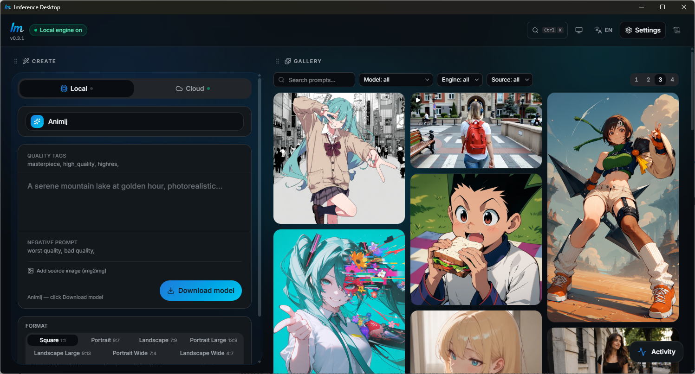

<div align="center">


# Imference Desktop

**Generate AI images and videos — on your own GPU or in the cloud. One app.**

Free · No subscription · Windows & macOS

[](https://github.com/Publikey/imference-desktop/releases/latest)
[](https://github.com/Publikey/imference-desktop/releases)
[](https://github.com/Publikey/imference-desktop/actions)
[](LICENSE)
[](https://github.com/Publikey/imference-desktop/stargazers)
[](#download)

**English** · [简体中文](README.zh-CN.md)

[**Download**](#download) · [Quick start](#quick-start) · [Website](https://imference.com/desktop) · [Contributing](CONTRIBUTING.md) · [Security](SECURITY.md)



</div>

<a id="download"></a>

## ⬇️ Download

| Platform | Download |
|---|---|
| **Windows** 10/11 (x64) | [**Installer**](https://github.com/Publikey/imference-desktop/releases/latest/download/imference-desktop-go-windows-amd64-installer.exe) · [Portable .exe](https://github.com/Publikey/imference-desktop/releases/latest/download/imference-desktop-go-windows-amd64.exe) |
| **macOS** 12+ (Intel & Apple Silicon) | [**.dmg**](https://github.com/Publikey/imference-desktop/releases/latest/download/imference-desktop-go-macos-universal.dmg) |
| **Linux** | No prebuilt binary yet — [build from source](#build-from-source) |

All versions and `checksums.txt` (SHA-256) are on the
[**Releases**](https://github.com/Publikey/imference-desktop/releases) page.

<a id="quick-start"></a>

## 🚀 Quick start

1. **Download** the installer for your OS above and run it.
2. **Open the app** — it installs its own inference engine and detects your GPU.
   Nothing touches your system Python.
3. **Pick a model, hit Generate** — the weights download automatically and every
   model ships pre-tuned, so your first image already looks right.

No GPU? Switch the toggle to **Cloud** in step 3 and generate on
[imference.com](https://imference.com) instead.

### ⚠️ First launch

The app isn't code-signed yet, so your OS shows a one-time warning. This is
expected — here's how to get past it:

- **Windows** — SmartScreen popup → click **More info** → **Run anyway**.
- **macOS** — right-click the app → **Open** → **Open**.
  If macOS still refuses: `xattr -cr "/Applications/Imference Desktop.app"`

You can verify your download against `checksums.txt` from the release.
The app checks for new versions at startup and shows a banner when one is
available; code signing and silent in-app auto-update are on the roadmap.

## Why Imference Desktop

- ⚡ **One-click setup** — the app installs an isolated inference engine for
  you (nothing touches your system Python), detects your GPU, and starts and
  stops the engine on demand. No terminal, no CUDA wrestling.
- 🖥️ **Local generation, $0 per image** — run **eight model families** on your
  own GPU: **SDXL, SD 1.5, Z-Image, FLUX, Chroma, Qwen-Image, Anima and
  Krea 2**. Your prompts and images never leave your machine.
- 🧩 **Preconfigured models, zero setup** — pick a model from the curated
  catalog and hit Generate: the weights **download automatically**, and every
  model ships pre-tuned (steps, CFG, resolutions, quality tags, negative
  prompt) so your first image already looks right.
- 🎨 **LoRAs** — stack up to four styles, characters or detail boosters on
  SDXL (Pony, Illustrious), Z-Image, Krea 2 and Anima models: pick them from
  the curated catalog (one-click download, weights pre-tuned) or import your
  own `.safetensors`. Works locally and in the cloud.
- 📦 **Bring your own model** — load any local `.safetensors` checkpoint
  (e.g. downloaded from Civitai) and pick its family. The file is used in
  place — nothing is copied or uploaded.
- ☁️ **Cloud when you want it** — no GPU or a weak one? Generate images and
  **video** on [imference.com](https://imference.com) from the same interface.
  Pay with an **API key (credits)** or **x402 (USDC on Base)** — the x402
  route needs no account at all.
- 🎛️ **Real controls, simple interface** — format, steps, CFG, seed, quality
  tags, negative prompt, **image-to-image**. Stack generations in a queue,
  and even switch models mid-run — the app finishes the current image first.
- 🗂️ **A gallery that remembers everything** — every image and video is saved
  with its prompt, model and settings. Filter, search, and review in a
  fullscreen viewer.
- 🪄 **Editing tools** — edit with instructions ("replace the sky with a
  sunset"), upscale, vary, remove background, magic eraser with
  click-to-select, expand (outpaint), repaint, restore faces, describe, and
  quick utilities (resize, crop, convert, strip metadata, video trim/convert)
  right from the gallery — on your machine or in the cloud.

<div align="center">

<!-- More screenshots: drop captures in docs/screenshots/ then uncomment -->
<!--
 
-->

</div>

## Editing tools

Right-click any image in the gallery (or open it and press **Edit**) to run a
tool on it. Every tool shows where it will run before you start:

| Badge | Meaning |
|---|---|
| **Local** | Runs on this computer at full speed (GPU, or a light CPU tool). Nothing is uploaded. |
| **Local (slow)** | Runs on this computer on the CPU — no compatible GPU runtime was found. Still private, just slower. |
| **Cloud** | This computer can't run it (engine not installed, not enough memory, no generation model loaded…): it runs on imference.com at the price shown. |

- **Where it runs.** Settings → *Editing tools* picks the default: **Auto**
  (local when the badge says so, otherwise the cloud), **Always local** or
  **Always cloud**; each run can override it. If a local run fails because the
  machine runs out of memory or lacks a runtime, the app *proposes* the cloud
  with its price — it never switches silently.
- **Privacy.** Local tools never upload anything. Cloud runs show *"Runs in
  the cloud: your image is uploaded"* and the price before you start; uploads
  are deleted from the cloud within 24 hours.
- **How it works.** Image and video tools run in a small separate tools engine
  (ONNX models of 2–500 MB, downloaded on first use and cached) that starts on
  demand and frees its memory after a few idle minutes. *Vary*, *Repaint* and
  *Expand* run on the generation model you have loaded (any model that does
  image-to-image). Results land in your gallery with a **tool** badge and the
  tool's settings in their metadata; you can chain another tool on a result.
- **Edit with instructions.** Describe the change in plain words ("replace
  the sky with a sunset", "remove the man on the left", "make it a watercolor")
  and optionally add up to two reference images ("put the hat from image 2 on
  the cat"). It uses an instruction-edit model (Qwen-Image-Edit 2511), not
  your text-to-image model; the instruction is saved as the result's prompt.
  - *Local*: load an edit model (Qwen-Image-Edit) as your local model. It
    needs a CUDA or ROCm GPU with about **12 GB of VRAM** (the app streams the
    20B transformer with group offload) and about **64 GB of RAM**. An edit
    model can't generate from a prompt: while it is loaded, Generate points
    you to *Edit with instructions*, and *Vary / Repaint / Expand* run in the
    cloud.
  - *Otherwise* it runs in the cloud on `qwen-image-edit-2511` (or another
    edit model you pick in the dialog) at that model's price.
- **Local API for AI agents.** While the app is open it serves a local API on
  `127.0.0.1` (port 47823 when free) protected by a random token, so agents —
  e.g. the Imference MCP server with `run_on: local` — can run tools on your
  machine for free. The port and token are in
  `<config dir>/imference-desktop-go/local-api.json` (`{"port","token","pid"}`,
  readable only by you, removed when the app quits):

  ```bash
  curl -H "Authorization: Bearer $TOKEN" http://127.0.0.1:47823/v1/tools
  curl -H "Authorization: Bearer $TOKEN" -X POST http://127.0.0.1:47823/v1/tools/upscale \
       -d '{"inputs": {"image": "/path/to/in.png"}, "params": {"scale": 2}}'
  # with an edit model loaded: references is a list (up to 2)
  curl -H "Authorization: Bearer $TOKEN" -X POST http://127.0.0.1:47823/v1/tools/instruct-edit \
       -d '{"inputs": {"image": "/path/in.png", "references": ["/path/hat.png"]},
            "params": {"instruction": "put the hat from image 2 on the cat"}}'
  ```

  Inputs may be absolute paths, `https://` URLs or `data:` URIs; outputs are
  saved to the gallery and returned as paths. Runs are local only (`503
  unsupported_runtime` when this machine can't run the tool). Turn the API off
  in Settings → *Editing tools*.

## Web version (prototype)

The same app, cloud-only, in a browser: `task build:web` (or
`cd frontend && npm run build:web && go build -tags "web server" -o bin/imference-web .`),
then `IMFERENCE_WEB_ADDR=127.0.0.1:8090 bin/imference-web` and sign in with an
imference.com API key.

How it works — one Go codebase, no business logic in TypeScript:

- `web_main.go` / `web_server.go` (build tag `web`): an HTTP server that runs
  **one cloud-only `App` per signed-in user** (own settings, pending cloud jobs
  and gallery under `IMFERENCE_WEB_DATA/users/<id>/`), with the same methods
  the desktop binds.
- The React frontend is built with `--mode web`: Vite aliases
  `@wailsio/runtime` to `src/lib/web-runtime.ts`, so the generated bindings
  keep calling `Call.ByID` (Wails' FNV-32a ID of `main.App.<Method>`) and
  `Events.On` — now over `POST /web/call` and Server-Sent Events
  (`GET /web/events`). `src/lib/target.ts` hides the local-only UI (engine,
  local mode, storage, x402 wallet).
- `web_rpc.go` is the policy: cloud methods are allowed, local status reads
  return empty values, local actions (engine, sidecar, file pickers, wallet,
  local models) answer 501. Settings writes only accept the cloud model; the
  API key is the session's; tools always run in the cloud and refuse file paths.
- Sign-in: `POST /web/login` checks the key against `GET /credits/balance`,
  then sets an `HttpOnly`, `SameSite=Strict` session cookie; every POST also
  needs the `X-Imference-Web: 1` header.

| Env | Default | |
|---|---|---|
| `IMFERENCE_WEB_ADDR` | `127.0.0.1:8090` | listen address |
| `IMFERENCE_WEB_DATA` | `web-data` | per-user data root |
| `IMFERENCE_BASE_URL` | `https://imference.com` | API base |
| `IMFERENCE_WEB_SECURE` | unset | `1` behind HTTPS (Secure cookie) |
| `IMFERENCE_WEB_BASE` | unset | path prefix, e.g. `/app` behind the imference API proxy |
| `IMFERENCE_WEB_GALLERY` | unset (`client`) | `server` keeps generated images on the server instead of the user's disk |

Container: `docker build -f Dockerfile.web -t imference-web .` (Node 22 +
Go 1.25 build stages, distroless non-root runtime, ~28 MB), then
`docker run -p 8090:8090 -v imference-web-data:/data imference-web`. The
frontend uses relative URLs only, so the same image serves `/` or `/app/`
(`IMFERENCE_WEB_BASE=/app`). On imference.com it sits behind the API's `/app`
reverse proxy (`WEB_APP_URL`, see the imference repo README). Base images are
overridable (`--build-arg NODE_IMAGE=... GO_IMAGE=...`) when Docker Hub
rate-limits.

**Gallery on the user's disk (default).** The server never keeps images: a
result comes back to the browser (image + metadata) and
`src/lib/web-gallery.ts` saves it, in the desktop format
(`<YYYYMMDD-HHMMSS>_<source>_<seed>.<ext>` + `.json` sidecar), either in a
folder the user picks (File System Access API: Chrome / Edge / Brave / Opera
desktop; Settings > Gallery) or in the browser's private storage (OPFS, every
browser) — the desktop app can point at the same folder and share the gallery.
`web-runtime.ts` keeps the gallery calls (`ListSavedImages`, `GalleryFacets`,
`GetSavedImage`, `DeleteSavedImage`) in the browser, saves `GenerateCloud` /
`RunTool` results, and sends gallery images to tools as data URIs with their
metadata. Cloud jobs that finish while no tab is open wait in a per-user server
outbox (`TakeClientGalleryOutbox`) until the next visit. `IMFERENCE_WEB_GALLERY=server`
keeps the previous server-side gallery.

Prototype limits: sessions live in memory (a restart signs everyone out) and
the server is single-instance; the API key is stored in the user's
`settings.json` on the server; no rate limiting; credits only (no x402). `go test -tags "web server" .` covers the
binding-ID mapping, sign-in/CSRF, the method policy, per-user isolation, the
event stream and a cloud generation end to end against a mock API.

## Requirements

| Mode | What you need |
|---|---|
| **Local** | Windows: an NVIDIA GPU (CUDA), or an AMD Radeon RX 7000/9000 (ROCm preview — needs Python 3.12 + a recent Adrenalin driver) · macOS: Apple Silicon. ~6–13 GB disk per model. |
| **Cloud** | Any machine — an [imference.com API key](https://imference.com/payments), or a funded x402 wallet. |

Linux (NVIDIA CUDA / AMD ROCm) is supported by the engine and builds from
source, but there's no prebuilt binary yet — see
[Build from source](#build-from-source).

Learn more about the app on the
[imference.com/desktop](https://imference.com/desktop) page.

## Feedback

This is an early public release — rough edges are expected.

- 🐛 **Something broken?** [Open an issue](https://github.com/Publikey/imference-desktop/issues/new/choose) — it directly shapes what gets built next.
- 💬 **A question, or not sure it's a bug?** [Discussions → Q&A](https://github.com/Publikey/imference-desktop/discussions/categories/q-a) — GPU support, install trouble, how-to.
- 🖼️ **Made something good?** [Show and tell](https://github.com/Publikey/imference-desktop/discussions/categories/show-and-tell).

<a id="build-from-source"></a>

<details>
<summary><b>Build from source</b></summary>

Built with [Wails v3](https://v3alpha.wails.io) (Go + React). This is also how
to run it on Linux, which the release workflow doesn't package yet.

Requires [Go](https://go.dev) 1.25+, [Node](https://nodejs.org) 20+, and the
Wails3 CLI:

```bash
go install github.com/wailsapp/wails/v3/cmd/wails3@v3.0.0-alpha2.116

wails3 dev      # run in dev mode (hot reload)
wails3 package  # production build + platform packaging (NSIS on Windows)
```

Releases are built automatically by GitHub Actions on a pushed `v*` tag
(see [`.github/workflows/release.yml`](.github/workflows/release.yml)).

See [CONTRIBUTING.md](CONTRIBUTING.md) for the repo layout, the checks to run
before a PR, and how to add a language.

</details>

## License

[MIT](LICENSE) © Publikey Sàrl

Model weights are **not** covered by this license — each model on the catalog
carries its own terms (CreativeML, FLUX non-commercial, Apache-2.0…). Check the
license of any model you use, especially commercially.

Found a security issue? See [SECURITY.md](SECURITY.md) — please don't open a
public issue.
