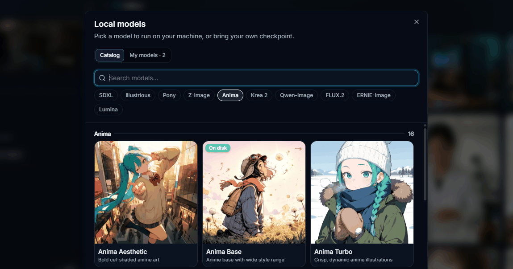
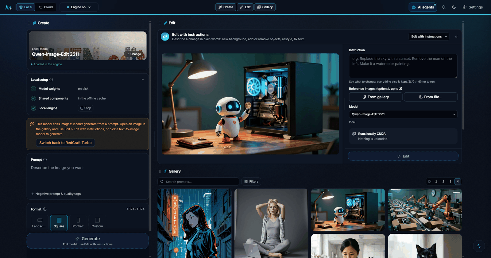
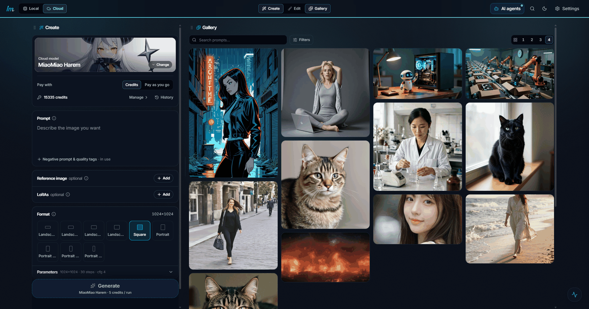

<div align="center">


# Imference Desktop

**90 个精选 AI 图像与视频模型，一个应用搞定。**
在自己的 GPU 上免费运行，也可以加载你已有的任意模型文件，
需要更多时切换到云端。

免费 · 无订阅 · Windows & macOS

[](https://github.com/Publikey/imference-desktop/releases/latest)
[](https://github.com/Publikey/imference-desktop/releases)
[](https://github.com/Publikey/imference-desktop/actions)
[](LICENSE)
[](https://github.com/Publikey/imference-desktop/stargazers)
[](#download)

[English](README.md) · **简体中文**

[**下载**](#download) · [快速开始](#quick-start) · [模型](#models) · [官网](https://imference.com/desktop) · [参与贡献](CONTRIBUTING.md) · [安全](SECURITY.md)


</div>

<div align="center">

| **90** | **15** | **75+** | **25+** | **0 元** |
|:---:|:---:|:---:|:---:|:---:|
| 精选模型 | 模型家族 | 可在自己的 GPU 上运行 | LoRA | 本地每张图 |

</div>

<a id="download"></a>

## ⬇️ 下载

| 平台 | 下载 |
|---|---|
| **Windows** 10/11 (x64) | [**安装程序**](https://github.com/Publikey/imference-desktop/releases/latest/download/imference-desktop-go-windows-amd64-installer.exe) · [便携版 .exe](https://github.com/Publikey/imference-desktop/releases/latest/download/imference-desktop-go-windows-amd64.exe) |
| **macOS** 12+（Intel 和 Apple Silicon） | [**.dmg**](https://github.com/Publikey/imference-desktop/releases/latest/download/imference-desktop-go-macos-universal.dmg) |
| **Linux** | 暂无预编译版本 — 请[从源码构建](#build-from-source) |

所有版本和 `checksums.txt`（SHA-256）见
[**Releases**](https://github.com/Publikey/imference-desktop/releases) 页面。

<a id="quick-start"></a>

<a id="quick-start"></a>

## 🚀 快速开始

1. **下载**上方对应系统的安装程序并运行。
2. **打开应用。** 它会在隔离环境中安装自带的推理引擎并检测 GPU。
   无需命令行，无需折腾 CUDA。
3. **选一个模型，点击生成。** 权重自动下载，每个模型都已预调好参数，
   第一张图就有不错的效果。

没有 GPU？把开关切到**云端**，在同一界面用
[imference.com](https://imference.com) 生成。

### ⚠️ 首次启动

应用暂未进行代码签名，因此系统会显示一次性警告。这是正常现象，通过方式如下：

- **Windows** — SmartScreen 弹窗 → 点击**更多信息** → **仍要运行**。
- **macOS** — 右键点击应用 → **打开** → **打开**。
  如果 macOS 仍然拒绝：`xattr -cr "/Applications/Imference Desktop.app"`

你可以用 Release 中的 `checksums.txt` 校验下载文件。
应用启动时会检查新版本并显示提示横幅；代码签名和应用内静默自动更新已列入路线图。

<a id="models"></a>

## 🎨 模型

获取模型有两种方式，可以混用：

- **精选目录**：90 个人工挑选的模型，一键下载，参数已预调好（步数、引导强度、
  分辨率、质量标签、负面提示词）。这是得到第一张好图最快的方式。
- **你自己的模型文件**：从 Civitai、Hugging Face 或其他地方下载的任意
  `.safetensors`。目录只是起点，不是限制。

### 精选目录，在自己的 GPU 上 — 11 个家族，75+ 个模型，每张图 0 元

| 家族 | 模型数 | 擅长什么 |
|---|:---:|---|
| **Illustrious** | 28 | 动漫与插画，社区模型最多。支持 LoRA。 |
| **Anima** | 16 | 新一代动漫模型，对提示词的理解更准确。支持 LoRA。 |
| **Krea 2** | 11 | 8 步生成写实与风格化图像。支持 LoRA。 |
| **Z-Image** | 9 | 8 步生成写实照片，速度快。支持 LoRA。 |
| **SDXL** | 3 | 经典的通用模型。支持 LoRA。 |
| **Pony** | 3 | 角色与风格化作品。支持 LoRA。 |
| **Qwen-Image** | 2 | 4 步生成，擅长文字与排版（Qwen-Image 2512）；按指令编辑图片（Qwen-Image-Edit）。 |
| **FLUX.2 klein** | 1 | 4 步出图；可按指令编辑参考图。 |
| **ERNIE-Image** | 1 | 图片内文字准确，8 步。 |
| **Lumina-Image 2.0** | 1 | Neta 系列动漫微调模型的基础模型。 |
| **LongCat-Image-Edit** | 1 | 8 步按指令编辑图片。 |

显存不够？对于 FLUX.2 klein、ERNIE-Image、Lumina-Image 和 Qwen-Image 2512，
应用会自动选择适合你显卡的版本；这四个模型都在 8 GB 显卡上实测过。

### 你已有的任意模型文件

目录里没有？照样可以加载。在模型选择窗口中点击**添加模型文件…**，选择本地的 `.safetensors` 文件，
再选好所属家族：

**SDXL**（Illustrious、Pony、NoobAI 以及其他所有 SDXL 微调模型）· **SD 1.5**
· **Z-Image** · **FLUX.1** · **Chroma** · **Qwen-Image** · **Qwen-Image-Edit**
· **Anima** · **Krea 2**

文件在原位置直接使用：不会被复制，也不会被上传。你的模型会和目录中的模型
显示在一起，使用同样的参数控制、LoRA 和图库。LoRA 也一样：可以导入自己的
`.safetensors`。

### 仅云端 — 另外 4 个家族，无需 GPU

| 家族 | 模型 | 类型 |
|---|---|---|
| **GPT Image**（OpenAI） | GPT Image-1、Image-2，以及 2.5 和 2.6 的 Flare 与 Sunburst | 图像，以及按指令编辑 |
| **FLUX 3** | FLUX 3、FLUX 3 Klein | 图像 |
| **MiniMax H3** | H3、H3 Max Turbo | 带声音的视频 |
| **Wan 3.0** | Wan 3.0 | 视频 |

大多数本地模型也能在云端运行（共 85 个模型），没有 GPU 的笔记本也能用上同一份
目录。可用积分付费，或用 **x402**（Base 链 USDC），后者无需注册账号。

## 为什么选择 Imference Desktop

- ⚡ **一键安装。** 应用会安装自带的引擎，自动检测 GPU，并按需启动和停止引擎。
- 🖥️ **本地、私密、免费。** 在自己的 GPU 上生成不花钱，提示词和图片永远不会
  离开你的电脑。
- 📦 **不设围墙。** 你已有的任意模型文件和 LoRA 都能用；目录是为了省去配置，
  不是为了限制你。
- ☁️ **需要时切换云端。** 同一界面，一个开关。更大的模型、视频，或者手边没有 GPU。
- 🧩 **25+ 个 LoRA。** 在 Illustrious、Pony、SDXL、Z-Image、Krea 2 和 Anima 上
  最多叠加四个风格、角色或细节增强。可从目录一键下载，也可导入自己的
  `.safetensors`。
- 🎛️ **真正的参数控制，界面简洁。** 画幅、步数、引导强度、种子、负面提示词、
  图生图。任务可排队，生成中途也能切换模型。
- 🗂️ **记住一切的图库。** 每张图片和视频都会连同提示词、模型和参数一起保存。
  支持筛选、搜索，并可复用以前的参数。
- 🪄 **内置编辑工具。** 按指令编辑、放大、去除背景、擦除物体、扩图、局部重绘、
  修复人脸。
- 🤖 **由你的 AI 智能体驱动。** 一键连接 Claude Desktop、Claude Code、Cursor
  或任何 MCP 应用，在对话里直接要一张图。

<div align="center">

<!-- 更多截图：把图片放进 docs/screenshots/ 后取消注释。
 
 
-->

</div>

## 🪄 编辑工具

在图库中右键任意图片，或打开图片后点**编辑**。

- **按指令编辑**：“把天空换成日落”“去掉左边的人”，最多可附两张参考图。
- **放大、变体、扩图、局部重绘、修复人脸。**
- **去除背景**和支持点击选取的**魔法橡皮擦**。
- **描述图片**，以及常用小工具：调整尺寸、裁剪、转换、清除元数据、
  视频裁剪和转换。

每个工具在运行前都会显示运行位置：在本机（不上传任何内容），或在云端并显示
价格。应用不会不经询问就切换到云端。详情见
[docs/editing-tools.md](docs/editing-tools.md)（英文）。

## 🤖 AI 智能体（Claude、Cursor…）

向 Claude 要一张图，由你自己的 GPU 免费生成，并实时显示在应用里。

1. 打开**设置 → AI 智能体**，点击 Claude Desktop 或 Claude Code 旁的**连接**。
   其他 MCP 应用可点**显示配置**获取配置片段。
2. 重启 AI 应用，然后说：*“用 Imference 生成一座暴风雨中的灯塔。”*

每次运行都会出现在活动面板中，标注为*来自 Claude*，并保存到图库。只有在你
允许时，云端运行才会消耗你的积分；该选项默认关闭。配置细节和本地 API 见
[docs/local-api.md](docs/local-api.md)（英文）。

## 系统要求

| 模式 | 需要什么 |
|---|---|
| **本地** | **Windows**：NVIDIA GPU（CUDA），或 AMD Radeon RX 7000/9000（ROCm 预览版，需要 Python 3.12 和较新的 Adrenalin 驱动）。**macOS**：Apple Silicon。需已安装 Python 3.11 或更高版本（应用会基于它创建自己的隔离环境）。每个模型约 6–13 GB 磁盘空间。 |
| **云端** | 任何电脑，加上一个 [imference.com API 密钥](https://imference.com/payments)，或一个有余额的 x402 钱包。 |

Linux（NVIDIA CUDA / AMD ROCm）引擎本身已支持，也可以从源码构建，
但目前还没有预编译版本 — 见[从源码构建](#build-from-source)。

应用还有一个仅云端的**网页版**（原型）：[docs/web.md](docs/web.md)（英文）。
更多信息见 [imference.com/desktop](https://imference.com/desktop) 页面。

### 🌐 界面语言

应用会自动跟随系统语言（支持英文和简体中文），也可以在
**设置 → 语言** 中手动切换。

## 反馈

这是一个早期公开版本，难免存在粗糙之处。

- 🐛 **遇到问题？**[提交 issue](https://github.com/Publikey/imference-desktop/issues/new/choose) — 它会直接影响后续开发方向。
- 💬 **有疑问，或不确定是不是 bug？**[Discussions → Q&A](https://github.com/Publikey/imference-desktop/discussions/categories/q-a) — 显卡支持、安装问题、使用技巧。
- 🖼️ **生成了满意的作品？**欢迎在 [Show and tell](https://github.com/Publikey/imference-desktop/discussions/categories/show-and-tell) 分享。

<a id="build-from-source"></a>

<details>
<summary><b>从源码构建</b></summary>

基于 [Wails v3](https://v3alpha.wails.io)（Go + React）构建。
在 Linux 上运行也走这条路径 — 发布流程目前还不打包 Linux 版本。

需要 [Go](https://go.dev) 1.25+、[Node](https://nodejs.org) 20+ 和
Wails3 CLI：

```bash
go install github.com/wailsapp/wails/v3/cmd/wails3@v3.0.0-alpha2.116

wails3 dev      # 开发模式（热重载）
wails3 package  # 生产构建 + 平台打包（Windows 上为 NSIS）
```

发布版本由 GitHub Actions 在推送 `v*` 标签时自动构建
（见 [`.github/workflows/release.yml`](.github/workflows/release.yml)）。

仓库结构、提交 PR 前需要跑的检查，以及如何新增语言，见
[CONTRIBUTING.md](CONTRIBUTING.md)。

</details>

## 许可证

[MIT](LICENSE) © Publikey Sàrl

模型权重**不在**本许可证范围内 — 目录中的每个模型都有各自的授权条款
（CreativeML、Apache-2.0、Lumina-Image 文本编码器的 Gemma 使用条款、GPT Image 和
FLUX 3 的服务商条款等）。使用任何模型前请先确认其许可证，
商用场景尤其如此。

发现安全问题？请见 [SECURITY.md](SECURITY.md) — 不要提交公开 issue。
