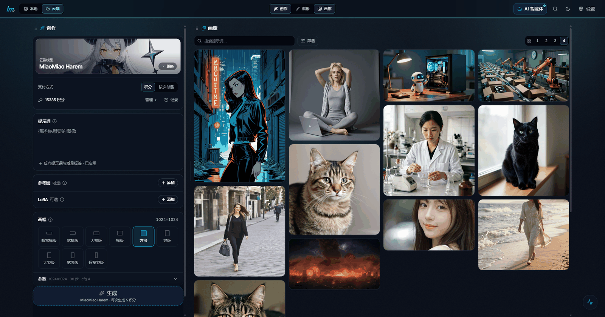
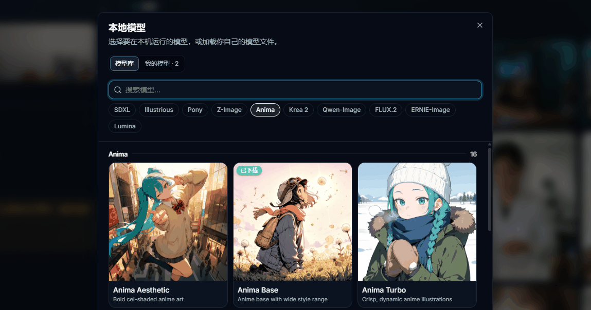
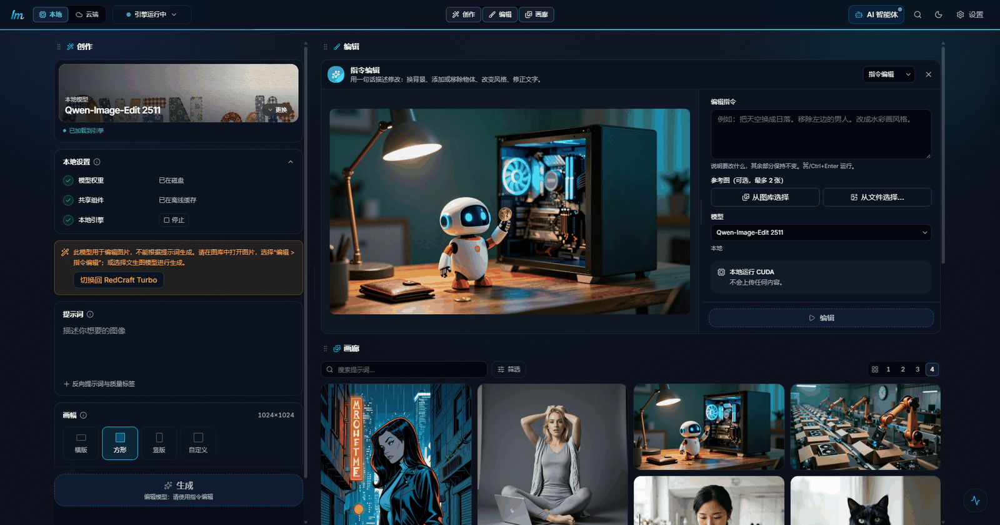

<div align="center">


# Imference Desktop

**AI 图像与视频：用自己的 GPU，或用云端。同一个应用，一个开关。**
一键安装，模型自动下载，无需账号。

免费 · 开源 · Windows & macOS

[](https://github.com/Publikey/imference-desktop/releases/latest)
[](LICENSE)
[](#download)

[English](README.md) · **简体中文**

[**下载**](#download) · [快速开始](#quick-start) · [模型](#models) · [官网](https://imference.com/desktop) · [参与贡献](CONTRIBUTING.md) · [安全](SECURITY.md)


</div>

### 🔀 本地与云端，同一个界面

在自己的 GPU 上免费生成，或者拨一下开关，把同一条提示词交给云端运行。
同一个界面、同一个图库、同一套工具：不用重新学习，每张图在哪里运行由你决定。

<div align="center">

</div>

### ⚡ 几分钟就能出图

安装、打开、选一个模型、点击生成。应用会安装自带的引擎、检测你的 GPU，
并替你下载权重。每个精选模型都已预调好参数，第一张图就有不错的效果。
无需命令行，无需连节点图，无需折腾 CUDA。

<div align="center">

</div>

### 🙅 无需账号

本地生成什么都不需要：不用注册，不用邮箱，提示词和图片永远不会离开你的电脑。
连云端也可以不用账号：用钱包按次付费，无需注册。

<a id="download"></a>

## ⬇️ 下载

| 平台 | 下载 |
|---|---|
| **Windows** 10/11 (x64) | [**安装程序**](https://github.com/Publikey/imference-desktop/releases/latest/download/imference-desktop-go-windows-amd64-installer.exe) · [便携版 .exe](https://github.com/Publikey/imference-desktop/releases/latest/download/imference-desktop-go-windows-amd64.exe) |
| **macOS** 12+（Intel 和 Apple Silicon） | [**.dmg**](https://github.com/Publikey/imference-desktop/releases/latest/download/imference-desktop-go-macos-universal.dmg) |
| **Linux** | 暂无预编译版本 — 请[从源码构建](#build-from-source) |

所有版本和 `checksums.txt`（SHA-256）见
[**Releases**](https://github.com/Publikey/imference-desktop/releases) 页面。

<a id="quick-start"></a>

## 🚀 快速开始

1. **下载**上方对应系统的安装程序并运行。
2. **打开应用**，等它安装好引擎：只需几分钟，只需一次。
3. **选一个模型，点击生成。** 模型会在第一次使用时自动下载。

没有 GPU？把开关切到**云端**，在同一界面用
[imference.com](https://imference.com) 生成。

### ⚠️ 首次启动

应用暂未进行代码签名，因此系统会显示一次性警告。这是正常现象，通过方式如下：

- **Windows** — SmartScreen 弹窗 → 点击**更多信息** → **仍要运行**。
- **macOS** — 右键点击应用 → **打开** → **打开**。
  如果 macOS 仍然拒绝：`xattr -cr "/Applications/Imference Desktop.app"`

你可以用 Release 中的 `checksums.txt` 校验下载文件。
应用启动时会检查新版本并显示提示横幅；代码签名和应用内静默自动更新已列入路线图。

<a id="models"></a>

## 🎨 90 个精选模型，开箱即用

每个模型都经过人工挑选和逐一调参，你不用再到处找合适的参数。
而且目录只是起点，不是限制：你从 Civitai、Hugging Face 或其他地方下载的
任意模型文件，都可以和目录中的模型一起使用。

支持的模型家族：

**Illustrious** · **Pony** · **SDXL** · **SD 1.5** · **Anima** · **Krea 2** ·
**Z-Image** · **Qwen-Image** · **Qwen-Image-Edit** · **FLUX.1** · **FLUX.2 klein** ·
**FLUX 3** · **Chroma** · **ERNIE-Image** · **Lumina-Image 2.0** ·
**LongCat-Image-Edit** · **GPT Image** · **MiniMax H3** · **Wan 3.0**

- **自己的模型文件。** 在模型选择窗口中点击**添加模型文件…**，选择本地的
  `.safetensors` 文件，再选好所属家族。文件在原位置直接使用：不会被复制，
  也不会被上传。LoRA 也一样。
- **显存不够？** 对于 FLUX.2 klein、ERNIE-Image、Lumina-Image 和 Qwen-Image，
  应用会自动选择适合你显卡的版本。
- **云端。** 带声音的视频（MiniMax H3）、视频（Wan 3.0）、GPT Image 和 FLUX 3
  在 [imference.com](https://imference.com) 上运行；没有 GPU 时，大多数本地模型
  也可以在云端运行。每张图 0.003 美元起，每段视频 0.15 美元起，可用积分或
  x402（Base 链 USDC）付费。

## ✨ 还有这些

- 🪄 **编辑工具。** 按指令编辑（“把天空换成日落”）、放大、去除背景、擦除物体、
  扩图、局部重绘、修复人脸。每个工具在运行前都会显示运行位置，应用不会不经
  询问就切换到云端。[详情](docs/editing-tools.md)（英文）
- 🤖 **让你的 AI 智能体来操作。** 在**设置 → AI 智能体**中连接 Claude Desktop、
  Claude Code、Cursor 或任何 MCP 应用，然后在对话里要一张图：由你自己的 GPU
  生成，并实时显示在应用里。[详情](docs/local-api.md)（英文）
- 🧩 **LoRA。** 叠加风格、角色和细节增强，可来自目录，也可用自己的文件。
- 🗂️ **记住一切的图库。** 每张图片和视频都会连同提示词、模型和参数一起保存。
  支持筛选、搜索，并可复用以前的参数。
- 🎛️ **真正的参数控制，界面简洁。** 画幅、步数、引导强度、种子、负面提示词、
  图生图。任务可排队，生成中途也能切换模型。

<div align="center">

</div>

## 系统要求

| 模式 | 需要什么 |
|---|---|
| **本地** | **Windows**：NVIDIA GPU（CUDA），或 AMD Radeon RX 7000/9000（ROCm 预览版，需要 Python 3.12 和较新的 Adrenalin 驱动）。**macOS**：Apple Silicon。建议 8 GB 显存，较小的模型 6 GB 即可运行。需已安装 Python 3.11 或更高版本（应用会基于它创建自己的隔离环境）。每个模型约 6–13 GB 磁盘空间。 |
| **云端** | 任何电脑，加上一个 [imference.com API 密钥](https://imference.com/payments)，或一个有余额的 x402 钱包。 |

Linux（NVIDIA CUDA / AMD ROCm）引擎本身已支持，也可以从源码构建，
但目前还没有预编译版本 — 见[从源码构建](#build-from-source)。

应用还有一个仅云端的**网页版**（原型）：[docs/web.md](docs/web.md)（英文）。
更多信息见 [imference.com/desktop](https://imference.com/desktop) 页面。

### 🌐 界面语言

应用会自动跟随系统语言（支持英文和简体中文），也可以在
**设置 → 语言** 中手动切换。

## 反馈

这是一个早期公开版本，难免存在粗糙之处。

- 🐛 **遇到问题？**[提交 issue](https://github.com/Publikey/imference-desktop/issues/new/choose) — 它会直接影响后续开发方向。
- 💬 **有疑问，或不确定是不是 bug？**[Discussions → Q&A](https://github.com/Publikey/imference-desktop/discussions/categories/q-a) — 显卡支持、安装问题、使用技巧。
- 🖼️ **生成了满意的作品？**欢迎在 [Show and tell](https://github.com/Publikey/imference-desktop/discussions/categories/show-and-tell) 分享。

<a id="build-from-source"></a>

<details>
<summary><b>从源码构建</b></summary>

基于 [Wails v3](https://v3alpha.wails.io)（Go + React）构建。
在 Linux 上运行也走这条路径 — 发布流程目前还不打包 Linux 版本。

需要 [Go](https://go.dev) 1.25+、[Node](https://nodejs.org) 20+ 和
Wails3 CLI：

```bash
go install github.com/wailsapp/wails/v3/cmd/wails3@v3.0.0-alpha2.116

wails3 dev      # 开发模式（热重载）
wails3 package  # 生产构建 + 平台打包（Windows 上为 NSIS）
```

发布版本由 GitHub Actions 在推送 `v*` 标签时自动构建
（见 [`.github/workflows/release.yml`](.github/workflows/release.yml)）。

仓库结构、提交 PR 前需要跑的检查，以及如何新增语言，见
[CONTRIBUTING.md](CONTRIBUTING.md)。

</details>

## 许可证

[MIT](LICENSE) © Publikey Sàrl

模型权重**不在**本许可证范围内 — 目录中的每个模型都有各自的授权条款
（CreativeML、Apache-2.0、Lumina-Image 文本编码器的 Gemma 使用条款、GPT Image 和
FLUX 3 的服务商条款等）。使用任何模型前请先确认其许可证，
商用场景尤其如此。

发现安全问题？请见 [SECURITY.md](SECURITY.md) — 不要提交公开 issue。
